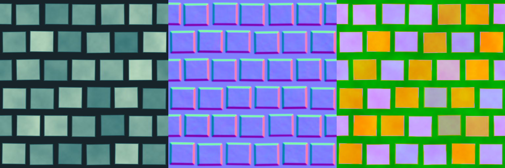

# 程序化节点：渐变、通道、图案与噪声

本批及补充更新共新增 10 个本地 GPU 节点，基于已有 Resize / Levels / Blend 与第一批材质处理节点继续扩展。节点职责参考 Substance Designer，算法与参数使用 AiCanvas 自身约定；不读取 `.sbs` / `.sbsar`，不保证与 Designer 逐像素相同。

## 节点一览

| 菜单 | 节点 | 用途 |
| --- | --- | --- |
| Filters/Adjustment | Gradient Map | 将灰度映射为多色标颜色渐变 |
| Filters/Adjustment | Histogram Range | 压缩和移动灰度输出区间 |
| Filters/Adjustment | Histogram Select | 提取指定灰度附近的软/硬蒙版 |
| Filters/Channels | RGBA Merge | 将四张灰度图打包为 RGBA |
| Filters/Channels | RGBA Split | 将 RGBA 拆为四路独立灰度图 |
| Filters/Channels | Channel Shuffle | 从两张图选取通道，或写入常量 0/1 |
| Generators/Gradients | Gradient Linear | 生成周期性线性或往返渐变 |
| Generators/Patterns | Shape | 生成圆盘、矩形和菱形 |
| Generators/Noises | Tileable Noise | 生成可复现、可平铺的分形值噪声 |
| Generators/Patterns | Tile Generator | 生成形状阵列、错行与随机变化 |

RGBA Split 提供 R/G/B/A 四路输出，其余节点提供 Image 输出。每个节点仅有一个 Preview，RGBA Split 通过 Channel 下拉菜单选择显示通道；均接入实时预览、Undo、图保存和 GPU 缓存。它们不调用 AI，也不需要配置服务连接。中间结果为半精度 GPU 纹理；Save 输出为 8 位 PNG。

## Gradient Map

输入 Grayscale 的**实际 R 通道**决定渐变位置；没有隐式亮度提取，彩色输入请先用 Grayscale 转换。输出尺寸继承输入，类型始终为 Color。

- **Gradient**：点击原生 Unity 渐变栏编辑，支持最多 8 个颜色色标和 8 个 Alpha 色标。默认黑白渐变、Alpha=1。颜色色标默认按标准 sRGB 录入，Alpha 始终是原始值。
- **Blend**：在 graph 的 Working Space 中插值 RGB，然后以线性 Color 传递。sRGB 与 Linear 模式可能产生不同的中间色。
- **Fixed**：沿用 Unity 原生 Fixed 的行为：位置刚越过前一色标时切换到下一色标，颜色和 Alpha 都如此。它与 Designer 的 No Interpolation 色标区间方向并不完全相同。
- **Perceptual Blend**：在线性颜色对应的 Oklab 空间插值颜色，Alpha 仍线性插值；这种模式本身定义了插值空间，因此不随 graph 工作空间改变颜色结果。
- **Address**：Clamp 将输入位置限制到 0–1；Repeat 使用小数部分，支持负数以及超出 1 的原始数据。输入恰好为整数时 Repeat 回到起点。
- **Multiply Input Alpha**：默认开启，输出 Alpha = 渐变 Alpha × 输入 Alpha；关闭后只使用渐变 Alpha。

第一和最后一个色标之外使用端点颜色。可从代码传入 `ColorSpace.Linear` 的 Gradient，此时颜色色标解释为线性值；原生控件以 sRGB 显示。色标会在创建执行计划时冻结为参数，不会因用户随后修改渐变而改变运行中的结果。

RGB 色标和 Alpha 色标分别插值，不作预乘 Alpha。渐变栏显示原生编辑器的插值预览；graph 使用 Linear 时，以节点 Preview 的实际运算结果为准。目前不包含从参考图片沿线采样渐变、Designer 的 Flat Tangents/Smooth 控制或 HDR 色标。

## Histogram Range 与 Histogram Select

两个节点均读取输入 R，输出 RGB 相同的 Data 图，Alpha=1；不会读取输入直方图。

**Histogram Range**：

- Range 为 0–1，默认 1，表示输出区间宽度。
- Position 为 0–1，默认 0.5，表示区间中心。
- 公式为 `saturate((saturate(R) - 0.5) × range + position)`。Range=1、Position=0.5 保持原有 0–1 灰度；Range=0 输出常量 Position；靠近两端的区间会被截断。

**Histogram Select**：

- Position 是选择区间的中心，Range 是完整宽度，默认都为 0.5。
- Contrast 默认 0.5；1 使用硬边界，边界值包含在选择内。降低 Contrast 会让区间向内柔化，中心保持白色。
- Range=0 不选择任何值；Invert 反相最终结果。
- 定义 `d = abs(saturate(R)-position)`、`h = range/2`。软过渡为 `saturate((h-d)/(h×(1-contrast)))`，硬边界为 `d <= h`。范围两端之外为黑色，不将区间整体搬回 0–1。

可用于分离高度层、选择噪声中的某段灰度，以及映射粗糙度区间。

## RGBA Split、RGBA Merge 与 Channel Shuffle

三者始终输出 **Data**，不进行额外颜色编码、Alpha 合成或预乘。外部打包贴图应关闭 Importer 的 sRGB；如果输入 Color 图，其实际通道值已经在线性 GPU 存储空间中，拆分和打包不会还原其 sRGB 文件字节。

**RGBA Split**：

- Input 为必需的 RGBA 图像输入；R、G、B、A 是四个独立的 Texture2D 兼容输出端口。
- 每路输出的 RGB 均为所选通道值，Alpha 固定为 1。A 输出是原图 Alpha 的灰度表示，便于显示、处理和重新打包。
- 四路均继承输入尺寸，不重采样、不限幅、不受 graph Working Space 影响；透明像素中的 RGB 数据也会保留。
- 单个 `Preview` 区域通过 `Channel` 下拉菜单切换 R/G/B/A，默认 R。选择随图保存并支持 Undo；Preview 按钮打开当前所选灰度输出，已打开的预览同步跟随选择。切换显示不重新执行 GPU 运算，也不改变四个输出端口的数据。
- 自动预览更新全部四路；Run Graph 按下游连接求值，只连接 A 时不会为其额外执行 R/G/B。
- 将四个端口依次连接到 RGBA Merge 的同名输入，即可还原输入的 GPU 通道数值（半精度精度范围内）；合并结果仍为 Data。

**RGBA Merge**：

- R、G、B 是必需输入，A 可选；缺省 A=1。
- 四个输入分别取 R 通道，写入输出 R/G/B/A；输入自身的 Alpha 不参与运算。
- 输出尺寸继承 R。其他尺寸使用各通道独立的双线性采样铺满输出画布，Clamp 边界。
- 可将 AO、Roughness、Metallic 等按项目约定打包。若需要取某张图的 G/B/A，可连接 RGBA Split 的对应端口。

**Channel Shuffle**：

- A 必需并决定输出尺寸，B 可选；缺省 B 的 RGBA 都为 1。
- Red/Green/Blue/Alpha Source 分别选择 A 或 B 的 R/G/B/A，或者常量 Zero/One。
- 默认复制 A 的 RGBA 数值。B 尺寸不一致时使用双线性重采样。

RGBA Split 的各输出独立缓存；同一端口连接多个下游只求值一次，重连到不同通道会更新计划和下游预览。

同一计划需要全部四路且均未命中缓存时，支持四个随机写入目标的设备使用一次 Dispatch 同时输出四路，减少重复输入读取和调度。部分命中缓存时仅计算缺失通道，全部命中时不 Dispatch。四路仍保留独立、全分辨率 RGBAHalf 纹理，因此切换 Preview 不触发计算，显存占用也不变：4096×4096 四路输出合计 512 MiB，不含输入和其他节点。

## 生成器通用参数

Width / Height 默认 1024×1024，支持非正方形和非 2 的幂尺寸；单边范围为 1 到设备上限与 16384 的较小值。生成器不需要输入图片，输出均为 Data，Alpha=1。

生成器以像素中心对应的 UV 计算：`uv=(pixel+0.5)/size`。重复图案表示其连续函数的周期相同，并不要求图片第一列与最后一列的像素数值完全一致。高周期、细小形状与低分辨率组合仍可能出现欠采样。

## Gradient Linear

- Direction：Horizontal 从左到右，Vertical 从下到上。
- Cycles：1–64，默认 1，表示完整画布中的周期数。
- Phase：0–1，默认 0，按周期平移。
- Mirror：关闭时为黑到白的锯齿渐变；开启后为黑→白→黑的往返渐变，首尾连续。
- Invert：反相结果。

计算 `t=frac(axisUV×cycles+phase)`，Mirror 时使用 `1-abs(2t-1)`。默认渐变的端部按像素中心采样，通常不会恰好等于 0 和 1。

## Shape

- Shape：Disc（圆盘）、Rectangle（矩形）、Diamond（菱形）。
- Size：每个轴 0.01–1，默认 0.8，表示形状占画布的宽高比例。
- Feather：0–1，默认 0，向内柔化边缘。即使为 0，也保留按像素尺寸估计的边缘抗锯齿。

形状居中，背景为 0、内部为 1，Alpha=1。按归一化画布尺寸定义；非正方形画布上的等比例 Size 不一定对应像素空间正圆。平移、旋转或镜像可串联 Transform 2D。

## Tileable Noise

- Scale：1–128，默认 8，基础周期 X/Y 两方向的格点数。
- Octaves：1–8，默认 4；每层频率翻倍。
- Roughness：0–1，默认 0.5；每层振幅相对上一层的比例。0 仅保留第一层。
- Seed：完整有符号整数，默认 0；控制可复现的随机格点值。
- Offset (UV)：每轴 -100–100，整数偏移返回相同周期。

这是采用周期格点、五次平滑插值及振幅归一化的分形**值噪声**，不是对 Designer 某个专有噪声节点的逐像素复制。每层格点都在该层周期内寻址，保证两方向的连续平铺。同一环境中相同参数可复现同一结果；随机性不依赖时间，Seed 改变会使缓存失效。

改变分辨率保留连续 UV 函数，但半精度存储及采样密度仍影响离散结果。Scale=1 且只有一层时，一个周期只有一个随机格点，因此结果为常量。

## Tile Generator

本批是**内置形状的灰度 Tile Generator**，不含自定义图片图案或 Tile Sampler 的控制贴图。

- Columns / Rows：各 1–64，默认 8。
- Shape：与 Shape 节点相同的 Disc、Rectangle、Diamond。
- Size：每轴 0.01–1，默认 0.85，表示相对格子的尺寸；减小可扩大间距。
- Feather：向内柔化。
- Row Offset：0–1，默认 0.5，奇数行的水平错位，单位为格子宽度。Rows 为奇数时，周期接缝两侧可能连续出现相同错位的行，这是该有限图案重复的结果。
- Rotation：-360–360 度，在格子坐标内旋转。
- Seed：控制各格子的随机变量。
- Jitter：0–0.5，每轴中心偏移的最大格子比例。
- Size Random：0–1；1 时每格统一缩放到基础尺寸的 10%–100%。
- Rotation Random：0–180 度，表示相对 Rotation 的最大正负偏移。
- Value Random：0–1，默认 0.15；从统一白色过渡到每格随机灰度。
- Missing：0–1，随机隐藏比例；1 强制全黑。
- Offset (UV)：每轴 -100–100，整体周期平移。

背景=0，多形状重叠时取最大值。随机数使用周期内的格子索引，因此跨边界的同一图案保持相同随机参数。采样相邻格子，支持跨边界的错位、旋转和中心抖动；抗锯齿与 Feather 不扩张形状的几何范围。

## 组合建议与后续

```text
Tile Generator → Gaussian Blur → Normal → Image Output
      └────────→ Gradient Map ───────────→ Image Output（颜色）
Tileable Noise → Histogram Range ────────→ RGBA Merge.G
Shape / Histogram Select ────────────────→ RGBA Merge.B
Uniform Color（Grayscale）───────────────→ RGBA Merge.R
                                          └──────────→ Image Output（打包数据）
```

从图案或噪声生成器开始，使用已有 Histogram Scan、Directional Warp、Blend 与 Normal 丰富材质。下一步优先扩展自定义图案与控制贴图驱动的 Tile Sampler，然后补充 Slope Blur、边缘/距离/形态处理和 Normal Blend。

## 可运行示例与验证

项目示例位于 `Assets/AiCanvasResource/Graphs/Procedural Material Demo.aicanvas`，可在 Unity 中双击打开。它使用 12 个节点，把 Tile Generator 与 Tileable Noise 混合为高度，再分支生成颜色、OpenGL 法线和通道打包输出；所有生成器均为 512×512。

下图为该节点图的实际输出，从左到右依次为 Base Color、Normal、打包数据。打包约定是 R=高度、G=粗糙度、B=Tile Selection 蒙版、A=1，不是 ORM 约定。



2026-09-19 在 Unity 6000.6.0b3、NVIDIA GeForce RTX 5060 环境完成 `Tsukuyomi.AiCanvas.Editor.Tests` 的完整 EditMode 回归：**87/87 通过，0 失败，0 跳过**。本批新增 19 个用例，覆盖 GPU 像素结果、渐变三种插值模式、颜色空间与原始通道、周期平铺与随机种子、缓存快照、保存重载、Inspector 编辑及 Undo、离线执行和 PNG 导出。

测试等待 GPU 回读时显式请求 Editor 更新，保留原有 20 秒超时，避免后台 Editor 无帧更新导致测试挂起。示例图另行执行并检查了三路输出。

同日补充 RGBA Split 后再次运行完整 EditMode 回归：**95/95 通过，0 失败，0 跳过**。新增 8 个用例覆盖四路实际 GPU 数值（含 sRGB 输入、透明像素和超出 0–1 的数据）、Split→Merge 往返、单独 A/B 输出寻址、共享分支缓存、局部运行与 Alpha PNG、保存重载、缺失输入/环路隔离，以及实际 Graph Toolkit 窗口中的四路预览绑定。

随后将 RGBA Split 合并为单个预览区域与 Channel 下拉菜单，更新实际图窗口用例并再次通过 **95/95** 回归，验证四通道切换、打开的预览同步跟随、选择保存重载及 Undo，同时确认切换不改变执行指纹或增加 GPU Dispatch。旧版四预览节点加载后只保留一个 Preview，四路输出连线保持完整。

## 参考

- [Adobe Gradient Map](https://experienceleague.adobe.com/en/docs/substance-3d-designer/using/substance-graphs/nodes-reference-for-substance-graphs/atomic-nodes/gradient-map)：灰度着色、多色标与渐变寻址职责。
- [Histogram Range](https://experienceleague.adobe.com/en/docs/substance-3d-designer/using/substance-graphs/nodes-reference-for-substance-graphs/node-library/filters/adjustments/histogram-range) 与 [Histogram Select](https://experienceleague.adobe.com/en/docs/substance-3d-designer/using/substance-graphs/nodes-reference-for-substance-graphs/node-library/filters/adjustments/histogram-select)：区间映射和区间蒙版。
- [RGBA Merge](https://experienceleague.adobe.com/en/docs/substance-3d-designer/using/substance-graphs/nodes-reference-for-substance-graphs/node-library/filters/channels/rgba-merge) 与 [Channel Shuffle](https://experienceleague.adobe.com/en/docs/substance-3d-designer/using/substance-graphs/nodes-reference-for-substance-graphs/atomic-nodes/channel-shuffle)：通道打包与重排职责。
- [Tile Generator](https://experienceleague.adobe.com/en/docs/substance-3d-designer/using/substance-graphs/nodes-reference-for-substance-graphs/node-library/texture-generators/patterns/tile-generator)：基础图案阵列和随机变化。
